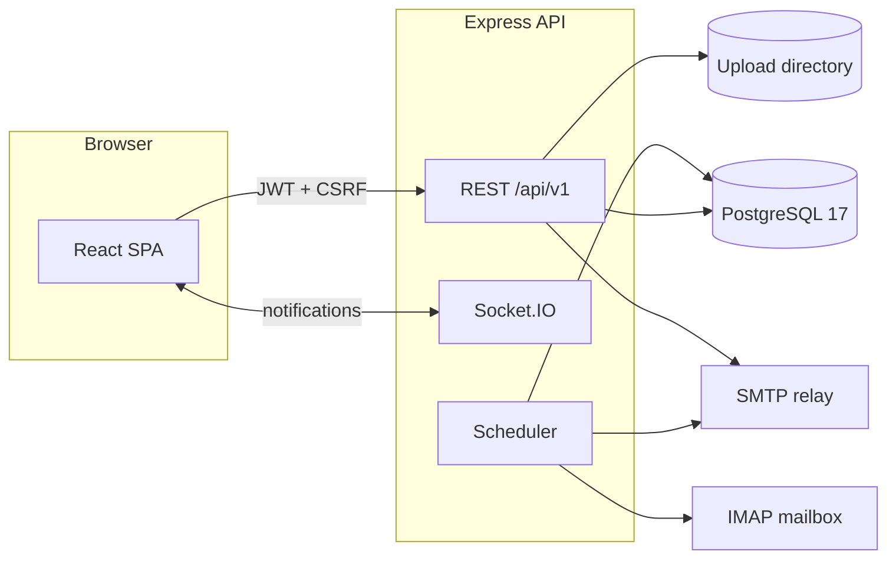
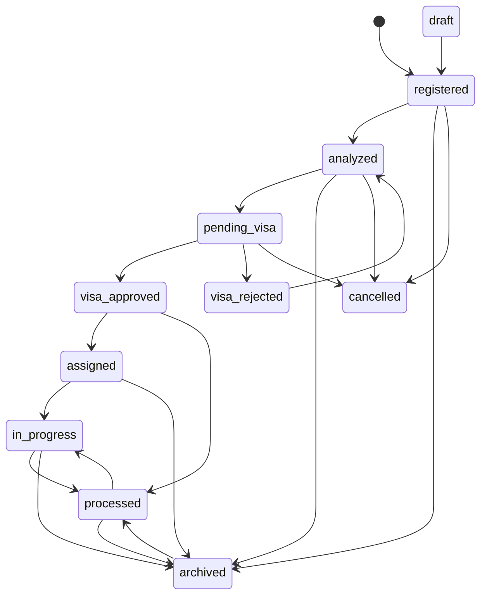

# Architecture

## Runtime view

## Layers

### Client (`client/`)

| Folder | Responsibility |
| --- | --- |
| `api/` | Axios instance, access-token refresh, CSRF header, file downloads |
| `auth/` | Session state, permissions, Socket.IO notifications |
| `components/` | Layout, guards, tables, dialogs, chips |
| `i18n/` | French and English resource bundles |
| `pages/` | Dashboard, mail list/detail/create, archive, users, reference data, reports, audit, admin, profile |
| `theme.js` | MUI palette, typography and component defaults |

The SPA keeps the access token in memory only. The refresh token and CSRF token
live in cookies; a silent refresh restores the session after a page reload.

### Server (`server/src/`)

| Folder | Responsibility |
| --- | --- |
| `config/` | Zod-validated environment, fails fast on invalid values |
| `db/` | Connection pool, migration runner, seed |
| `middleware/` | Authentication, CSRF, rate limits, uploads, errors, request IDs |
| `routes/` | Thin HTTP layer with Zod validation |
| `services/` | Mail CRUD, workflow, analytics, notifications, email, OCR |
| `lib/` | Audit, tokens, passwords, permissions, storage, serialization |
| `jobs/` | SLA reminders, cleanup and IMAP polling |
| `realtime.js` | Socket.IO gateway authenticated with the access token |

Business rules live in services; routes only validate input, check
permissions and shape responses.

## Request lifecycle

1. `requestId` assigns a correlation ID.
2. Pino logs the request and response.
3. Helmet, CORS and compression run.
4. `/api/v1/health` and `/api/v1/auth` are public (rate limited).
5. Every other `/api/v1` route requires a valid access token.
6. Route-level `requirePermission` enforces RBAC.
7. Zod validates body, params and query.
8. The service runs inside a transaction when it writes multiple tables.
9. `audit()` records sensitive mutations.
10. Errors are normalized by the central error handler.

## Authentication

- Passwords hashed with bcrypt (cost 12 in production).
- Access token: JWT, 15 minutes, `Authorization: Bearer`.
- Refresh token: 32-byte random value, hashed in `refresh_tokens`, rotated on
  every refresh and revoked on logout or password change.
- CSRF: double-submit cookie for cookie-authenticated endpoints
  (`/auth/refresh`, `/auth/logout`, `/auth/change-password`).
- MFA: TOTP with recovery codes, verified during login.
- Lockout: five failed attempts lock the account for 15 minutes.

## Mail workflow

The pure transition table is in `server/src/lib/workflowState.js`, which keeps
the state machine testable without a database.

## Realtime

Socket.IO clients authenticate with the same JWT. The server joins each socket
to `user:<id>` and broadcasts notifications to the assignee, watchers and
department when a record changes.

## Deployment topology

- `db` — PostgreSQL 17 with a named volume and health check.
- `api` — Node.js image running migrations at start, then the API.
- `web` — Nginx serving the compiled SPA and proxying `/api` to `api`.

The API can also serve `client/build` directly for single-container
deployments.
